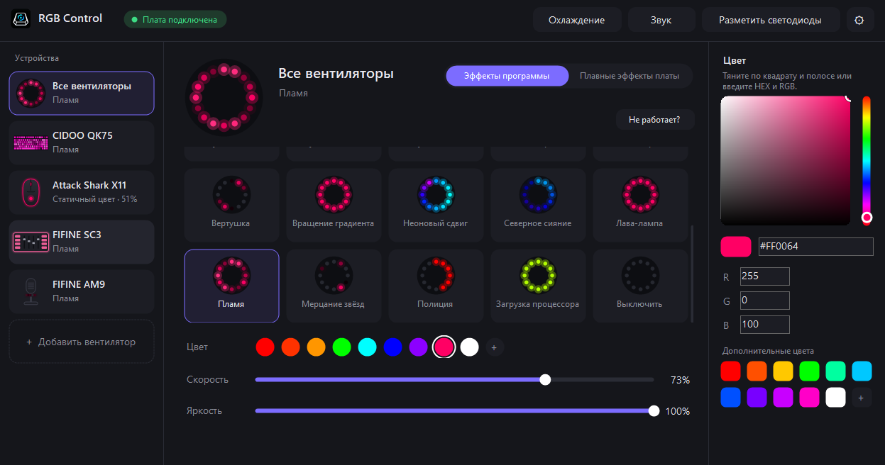
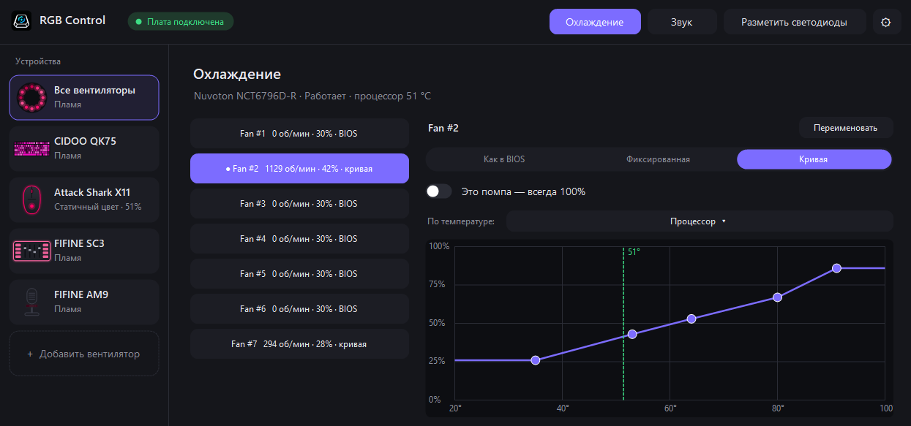
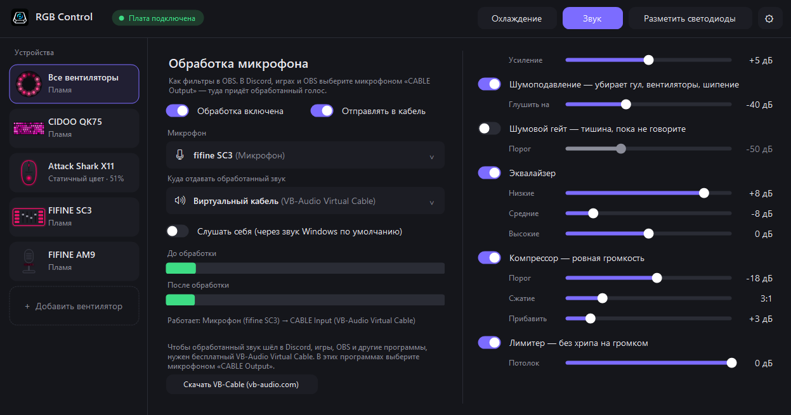

# RGB Control

**English** · [Русский](README.md)

A lightweight Windows app for RGB lighting, fan & pump curves and microphone processing — all in one small window.

**[⬇ Download the latest version](../../releases/latest)** — `RGB Control Setup X.Y.exe`

> [!IMPORTANT]
> **Device not working or not listed? Send a report — it takes 10 seconds.**
> In the app: the **«Не работает?»** ("Not working?") button on a device screen, or **⚙ → «Сообщить о проблеме»** ("Report a problem") → «Отправить» ("Send"). No personal data is sent.
> New devices get supported from exactly these reports — usually within a few days. [More](#something-doesnt-work)

> The interface is currently in Russian. An English UI is planned.

---

## Features

- **Lighting** — effects (rainbow, wave, breathing, fire, meteors and more), custom colors, all devices in sync. Fans on the motherboard can be mapped one by one. Keyboards get their built-in firmware effects and a "Lights off" button; keyboards can be swapped on the fly.
- **Cooling** — fan and pump curves by temperature, fixed speed or "as in BIOS". NVIDIA graphics card fans can be tuned too. The "Quiet curve" mode makes case, CPU and GPU fans noticeably quieter with one click while still ramping up when hot. On overheating fans jump to 100% automatically.
- **Sound** — OBS-style microphone processing: RNNoise neural noise suppression, noise gate, EQ, compressor, limiter. The processed voice can go to Discord and games via VB-Audio Virtual Cable.
- **Setup check** — on first launch the app scans your PC against a catalog of ~2,500 RGB devices and shows what it controls and what is not supported yet.
- **Stays out of the way** — almost no CPU load, lives in the tray, starts with Windows.

| Cooling | Sound |
|---|---|
|  |  |

## Supported hardware

### ✅ Tested

| Type | Models |
|---|---|
| Motherboards (ARGB headers) | ASRock Polychrome USB — tested on ASRock B550M Pro RS and B550M Pro SE |
| Cooling | Fans and pump via Nuvoton chips (tested on NCT6796D-R) |
| Graphics cards | MSI RTX 5060 Gaming Trio; Palit RTX 3070 GameRock (whole card in one colour, with white balance) |
| RAM | ENE DIMM_LED-0103 controllers (ADATA XPG) |
| Keyboards | Cidoo QK75 (per-key lighting with the unofficial firmware from [`firmware-qk75`](firmware-qk75), at your own risk); Ajazz AK820 wired single-colour — 20 effects, brightness and speed |
| Mice | Attack Shark X11 |
| Mixers | FIFINE AmpliGame SC3 (lighting needs the unofficial [RGB+](https://github.com/wopln/FIFINE-SC3-RGB-Plus) firmware, at your own risk) |
| Microphones | FIFINE AmpliGame AM9 |

### 🟡 Expected to work, not tested yet

- **ASUS motherboards** with the Aura USB controller (X570/B550 generation and newer: ROG, TUF, Prime, Strix) — since 2.8. Armoury Crate must be closed.
- **Attack Shark mice** X6, R1, X3, X3 Pro, X3 Max, X8 Plus — since 2.8. The model is detected automatically (or picked by hand); until it is known, DPI is left untouched.
- **Cidoo keyboards** on QMK/VIA: QK61, QK61 V2, V21, V33, V65 Pro, V68, V75, V75 Plus, V87, ABM066, ABM098, Stellar, Nebula — since 2.8. Built-in keyboard effects, color, brightness and speed; the app detects the control method and effect list by itself.
- **FIFINE** — microphones, headsets and mixers on the same protocol as the AM9, and headphone stands with lighting — since 2.8.
- **Palit / PNY / Gainward graphics cards** of other models with the same lighting controller — since 2.8.
- **Any QMK/VIA keyboard** — Keychron, GMMK, Akko and others with VIA support: effects, colour, brightness and speed. Effect names come from the VIA keyboard definitions (Keychron and nearly 200 other models with their own effect sets); others get the standard QMK list or numbered effects.
- **Gigabyte motherboards with RGB Fusion 2** (ITE USB controller: B450 AORUS, X570, B550, B650, X670, Z690 and newer) — since 3.1. For now the whole board lighting is one colour driven by the app's effects. RGB Fusion / Gigabyte Control Center must be closed.
- **Epomaker and Attack Shark keyboards on the ROYUAN chip** — TH80, TH80 V2, HE68 Lite, K86 and others — since 3.1. Built-in effects, colour, brightness and speed, wired only. On connect the app only reads the keyboard's mode.
- **WLMOUSE mice** — Beast G, Beast X / X Pro / X V2, Beast Max, Beast Mini / Mini Pro, Beast Miao, Strider, Ying, Sword X, HUAN — since 3.2. DPI stages, polling rate, lift-off distance, debounce, sleep time, Angle Snap, Motion Sync, Ripple Control, Hyper Mode, battery; DPI button presses on the mouse are shown. On connect the settings are only read.- **RAM** with other ENE controllers — ASUS, G.Skill Trident Z, TeamGroup T-Force, Patriot Viper and others.
- **Graphics cards** — other MSI RTX 40/50 series.
- **Cooling** on other motherboards supported by LibreHardwareMonitor.

If you have such hardware, please try it and tell us whether it works.

### ❌ Not supported yet

MSI motherboards, older ASUS boards (X470 and earlier), graphics cards from other vendors, Corsair and Kingston Fury RAM, Razer / Logitech / SteelSeries peripherals and much more. Support is added based on reports — see below.

**Ajazz keyboards on Sonix and Sinowealth chips** (AK980, AK870, AK820 MAX, AK820 PRO and others), **Ajazz mice**, the **FIFINE AM8** microphone and lighting on older **Gigabyte** boards (RGB Fusion 1) are recognized but not controlled yet. If you have one, press **«Хочу поддержку — отправить отчёт»** ("I want support — send a report") in the hardware window: support is added quickly from such a report.

## Installation

1. Download `RGB Control Setup X.Y.exe` from [Releases](../../releases/latest) and run it.
2. Windows may show "Windows protected your PC" — the installer is not code-signed yet. Click **More info → Run anyway**.
3. The app installs for the current user, no admin rights needed. Optionally the installer:
   - installs the **PawnIO** driver — needed for fans, pump and RAM lighting;
   - enables **"Always run as administrator"** — cooling and RAM only work with admin rights; Windows asks once.
4. New versions install on top; settings are kept. Uninstall via Settings → Apps.

**Requirements:** Windows 10 or 11 (64-bit). To send the processed voice to other apps — the free [VB-Audio Virtual Cable](https://vb-audio.com/Cable/).

## Something doesn't work?

The easiest way is right from the app: the **«Не работает?»** ("Not working?") button on a device screen, or **⚙ → «Сообщить о проблеме»** ("Report a problem"). Describe the issue in a few words and press send. The author receives your text, hardware info and the error log — no personal data; you can preview everything before sending.

Or open an [issue](../../issues/new/choose) and attach the compatibility report: **⚙ → «Сохранить отчёт совместимости»** ("Save compatibility report") — it appears on your desktop.

Want your device supported? Send the report as well — it shows how the device works.

## ♥ Support the project

RGB Control is free and ad-free, and will stay that way. But it's a complex project: every new device has to be bought or found, its protocol reverse-engineered and tested on real hardware. Supporting the author directly speeds up development — more devices and faster updates.

**[♥ Support the author](https://yoomoney.ru/fundraise/1L4NNQSOMHG.261025)** — any amount (YooMoney, Russian bank cards). Thank you!

## Safety

- The app only touches lighting and fans. It never writes to RAM SPD or BIOS settings.
- Unknown devices never receive commands — the app only reads what they report about themselves.
- On exit, devices return to their own effects and fans go back to BIOS control. Even if the app crashes, fans are handed back to BIOS first.

> [!WARNING]
> **Device firmware is unofficial, optional and at your own risk.** Manufacturers did not release or support it, warranty may be void, and LumenWorks is not responsible for your devices.
> - **Cidoo QK75** — the stock firmware is not included (you can request it from Cidoo support). Don't flash unless you are sure.
> - **FIFINE SC3** — the [RGB+](https://github.com/wopln/FIFINE-SC3-RGB-Plus) firmware (by wopln) is not part of RGB Control: download it and its tool from the author and follow their instructions.
>
> Everything else in RGB Control works without this firmware.

## Author and license

© 2026 **LumenWorks**. Free but closed-source — see [LICENSE.txt](LICENSE.txt). Third-party components and their licenses: [THIRD-PARTY-NOTICES.md](THIRD-PARTY-NOTICES.md).

The Cidoo QK75 firmware source is open under GPL-2.0 — see [`firmware-qk75`](firmware-qk75).
